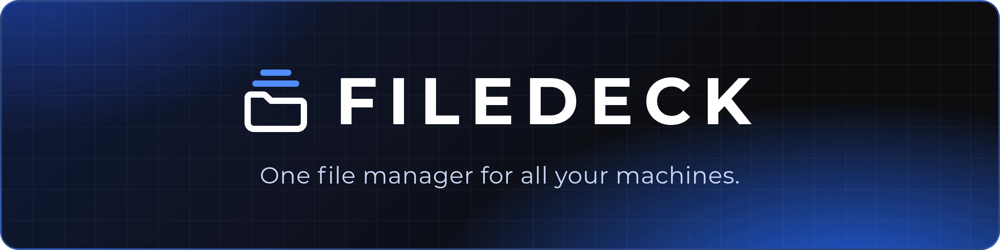
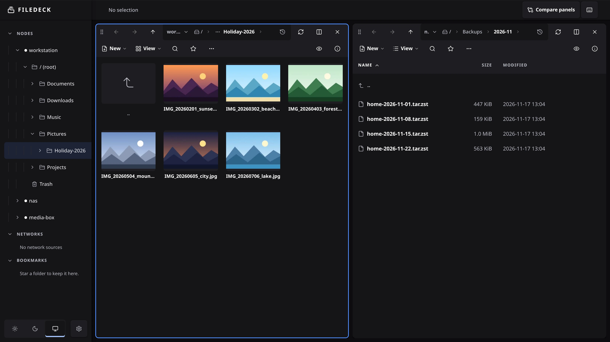
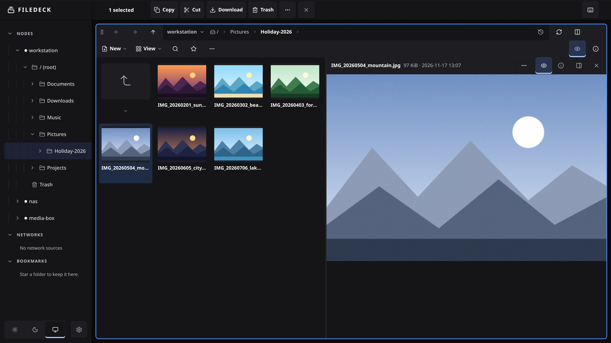
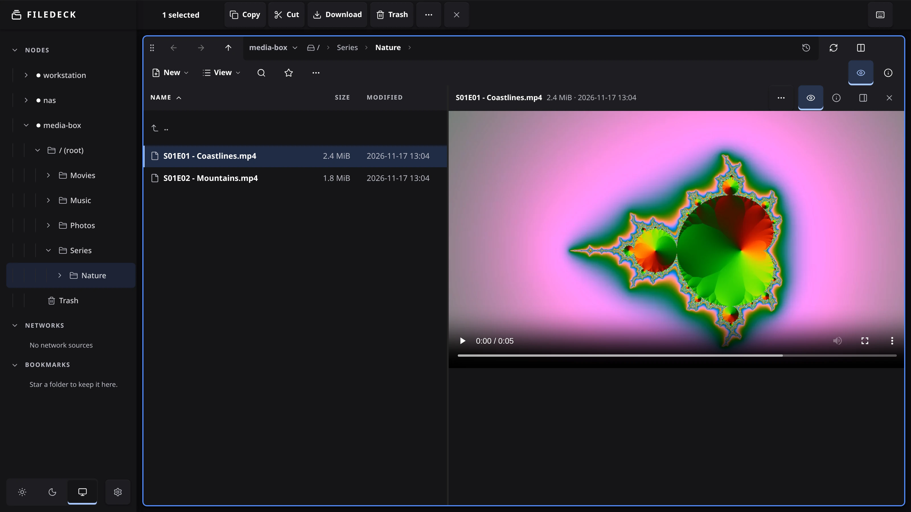
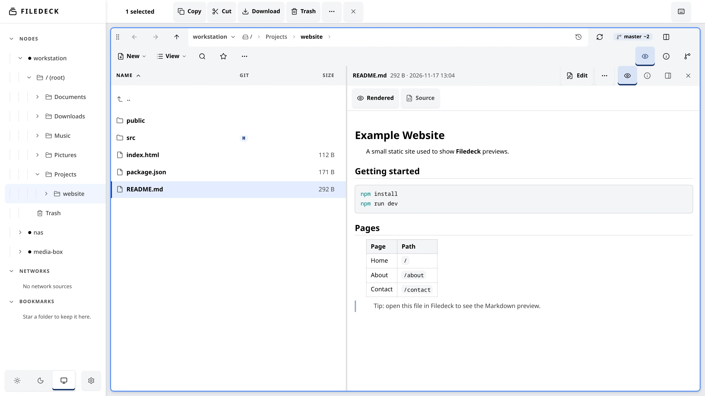
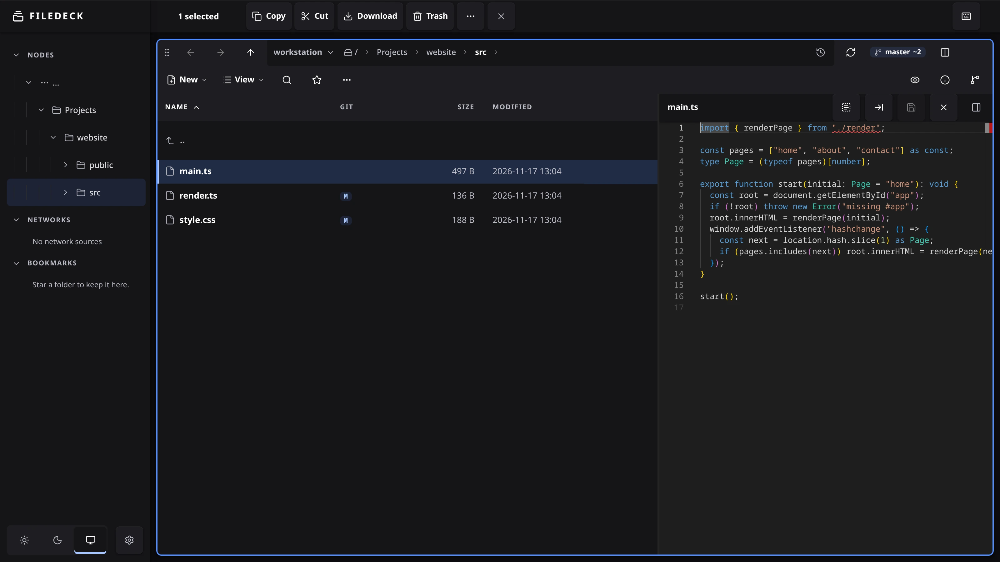
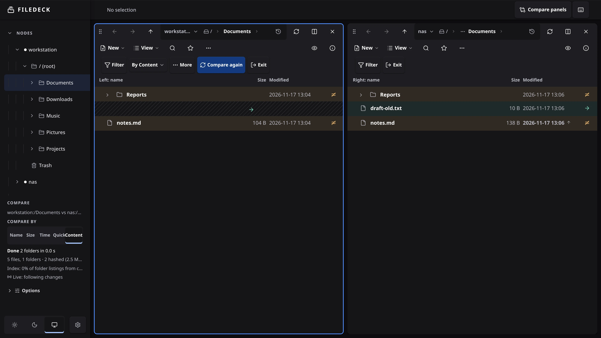
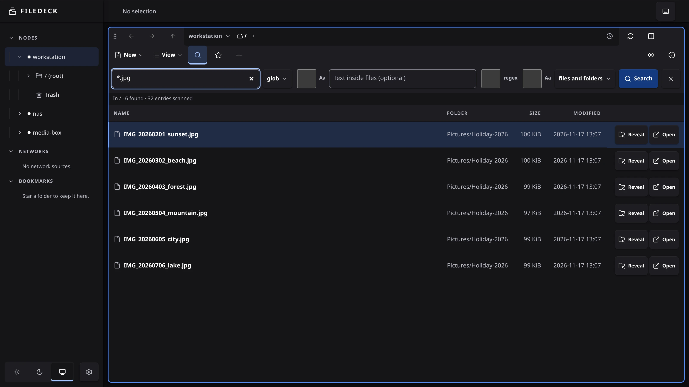
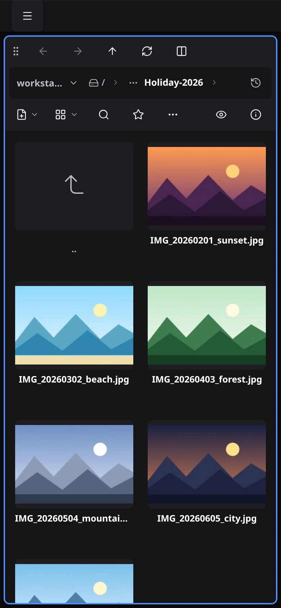

<p align="center"></p>

<p align="center"></p>

Filedeck lets you browse, preview, edit and move files on many machines from one web page. Open two panels side by side, one on your workstation and one on your NAS, and drag files between them. Big copies run as jobs on the server and show their progress.

> The screenshots show demo data on three made-up machines: `workstation`, `nas` and `media-box`.

## What you can do

- 🗂️ **Work in panels.** Two panels (or more) side by side, each on any machine. Use bookmarks, a folder tree and a history of recent folders.
- 🔁 **Move files between machines.** Drag and drop, or copy and paste, from one machine to another. Bulk jobs show their progress.
- 👀 **Preview almost anything.** Images, video (converted on the fly when the browser cannot play it), audio, PDF, Markdown, Word, Excel, PowerPoint, OpenDocument and hex.
- ✏️ **Edit text and code.** A built-in Monaco editor (the editor from VS Code), with a diff view and Git status.
- 🔍 **Search.** By name, glob or regular expression, and optionally by text inside files.
- ⚖️ **Compare and sync folders.** Compare two folders by name, size, time or content, then sync them.
- 📦 **Work with archives.** Browse, extract and create zip, 7z and tar archives, with passwords and split volumes.
- 🗑️ **Undo mistakes.** Deleted files go to a trash on each volume first.
- 🌐 **Reach network storage.** SFTP, WebDAV, S3 and SMB sources sit beside your machines.
- 📏 **Find what fills the disk.** `filedeck du` answers like `du`, from stored folder sizes.
- 📱 **Use it anywhere.** Dark and light themes, a phone layout, and full keyboard control.

## A quick tour

### Preview photos, video and documents

<p align="center">
  
  
</p>

### Read Markdown, edit code

<p align="center">
  
  
</p>

### Compare folders across machines

<p align="center"></p>

### Search everywhere

<p align="center"></p>

### On your phone

<p align="center"></p>

Install it as an app from the browser (Settings, "Install app", or the browser's own menu) to get the Filedeck icon on the home screen and a window of its own. It opens without a network and says when the hub cannot be reached, offers "Reload" when a new version is deployed, and can notify you when a copy, move, compress, extract, sync or compare finishes or fails, also while the app is closed (switch it on in Settings; the hub sends these by Web Push, with keys it makes itself). The service worker stores only the app itself, never file contents or anything the API answers.

## How it works

Filedeck is one container image that runs in two modes:

- An **agent** runs on each machine and serves that machine's files.
- A **hub** serves the web app. It talks to the agents and runs the bulk jobs, folder compares, transfers between machines and network sources.

```text
                 browser
                    │
                   hub ──── network sources (SFTP, WebDAV, S3, SMB)
        ┌───────────┼───────────┐
      agent       agent       agent
  (workstation)   (nas)    (media-box)
```

## Try it

### On Kubernetes with Helm

Download the chart archive from the [latest GitHub release](https://github.com/DynacomSolutions/filedeck/releases), then install it:

```sh
helm install filedeck ./filedeck-0.4.2.tgz -n filedeck --create-namespace
kubectl -n filedeck port-forward svc/filedeck 8080:80   # then open http://127.0.0.1:8080
```

The default gives you one agent that browses its node's files. To add machines, network sources, a token and more, see [Install with Helm](docs/install.md).

### On your own computer

You need Node 22.

```sh
npm ci
npm run build
FILEDECK_ROOT=$HOME npm run dev:agent             # agent on :8080
HUB_URL=http://127.0.0.1:8080 npm run dev:web     # then open the address Vite prints
```

See [Development](docs/development.md) for tests, the native helpers and running a hub with several agents.

## ⚠️ Keep it on a trusted network

Filedeck has **no user accounts**. Anyone who can reach the hub can use it, and agents can change any file they serve. Put it behind a VPN or a private ingress with its own login.

To limit the risk further:

- Lock agents to the hub with a network policy and a shared token (`FILEDECK_AGENT_TOKEN`).
- Make folders read-only with `FILEDECK_READONLY`.
- Read the audit log: every request that changes something is written to stdout as one JSON line.
- Tools that read other people's data (Git, `bsdtar`, `7zz`) run in a Linux Landlock sandbox. See [Sandbox and safe file placement](docs/security.md).

## Documentation

| Guide | What is in it |
|---|---|
| [Install with Helm](docs/install.md) | Chart values, agent tokens, network policies, the vault volume |
| [Configuration](docs/configuration.md) | Every environment setting for the agent and the hub, branding |
| [Archives and passwords](docs/archives-and-passwords.md) | Compress and extract, password-protected files, saved passwords (the vault) |
| [`filedeck du`](docs/filedeck-du.md) | The disk usage command, its token and the stored sizes file |
| [Sandbox and safe file placement](docs/security.md) | What the sandbox allows each tool, and how moves never overwrite |
| [Development](docs/development.md) | Repository layout, build, tests, running locally |
| [Contributing](CONTRIBUTING.md) | Rules for code and pull requests |
| [Accessibility audit](docs/accessibility/wcag-2.2-audit.md) | WCAG 2.2 audit results |

## Licence

MIT, see [LICENSE](LICENSE). The bundled Montserrat fonts are under the SIL Open Font License 1.1 (`web/public/assets/fonts/OFL.txt`).

The logo is a folder with a deck of two cards behind it (`web/public/logo-mark.svg`, `logo-wordmark.svg`, `favicon.svg`).
